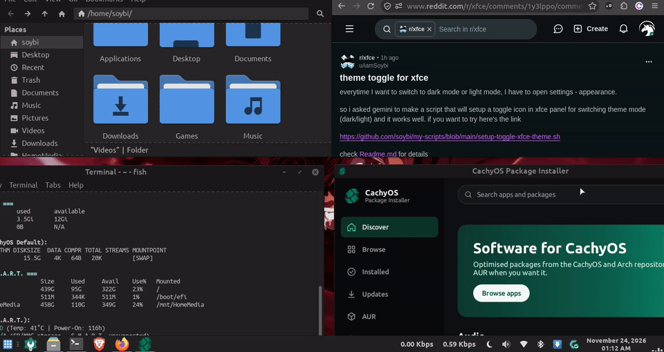

# My Linux Utility & Setup Scripts

A personal collection of Bash utilities, hardware workarounds, and automated system setup scripts for **CachyOS (Arch Linux)** and **Debian** homelab environments.

---

## Included Scripts

### 1. `linux-health.sh` — Cross-Distro Linux System Health Reporter
A lightweight, dependency-minimal terminal diagnostic tool that works on **any mainstream Linux distribution**: Arch/CachyOS, Debian/Ubuntu, Fedora/RHEL, openSUSE, Alpine, Void, and their derivatives. It uses optional tools when they are installed and skips them gracefully when they are not, so it runs cleanly on minimal installs, VMs, and containers too.

**Features:**
- **System & Kernel:** Displays the distro name (from `/etc/os-release`), kernel version, architecture, and uptime.
- **CPU, Load & Temperatures:** Shows CPU model, live utilization sampled from `/proc/stat`, load averages, and hardware sensor temperatures (`lm_sensors`, falling back to `/sys/class/thermal`).
- **GPU Detection:** Lists single or dual-GPU configurations (Intel iGPU + NVIDIA dGPU) and live NVIDIA metrics when available. Falls back to sysfs vendor detection if `lspci` is missing.
- **Memory & Swap/ZRAM:** Summarizes RAM and swap usage from `/proc/meminfo`, plus ZRAM stats when `zramctl` reports active devices.
- **Storage & S.M.A.R.T.:** Reports physical partition usage (filtering out virtual filesystems), masks SMB network share IPs by default, and queries drive S.M.A.R.T. health, temperatures, wear, and power-on hours.
- **Network & Internet:** Checks the active interface, ICMP latency, and DNS resolution while keeping local and public IP addresses hidden by default.
- **Services & Package Health:** Flags failed systemd units (skipped automatically on non-systemd distros) and reports unused packages and package cache size for `pacman`, `apt`, `dnf`, `zypper`, `apk`, and `xbps`.

**Usage:**
```bash
linux-health.sh                  # Run full health check (IPs hidden for screenshot privacy)
linux-health.sh --ip             # Reveal local LAN IP, public WAN IP, and SMB share IPs
linux-health.sh --export         # Save a clean plain-text report (health-report-YYYYMMDD-HHMMSS.txt)
linux-health.sh -e ~/report.txt  # Export report to a custom file path
NO_COLOR=1 linux-health.sh       # Disable colored output
```

> If you followed the symlink step in [Quick Installation](#quick-installation), the command is simply `health` instead of `linux-health.sh`.

---

### 2. `scrolllock.sh` (and `cachyos-xfce-scrolllock-led-bundle.zip`)
Configures keyboard Scroll Lock LED toggling on X11/XFCE desktop environments (commonly required for backlit budget/gaming keyboards on Linux).

**Usage:**
```bash
chmod +x scrolllock.sh
./scrolllock.sh
```

---

### 3. `setup-gt630m-tf2.sh`
Configures legacy NVIDIA GeForce GT 630M drivers and Optimus/hybrid graphics offloading specifically tuned for running *Team Fortress 2* on Linux.

---

### 4. `revert-all-nvidia-setup.sh` & `revert-all-nvidia-setup-v2.sh`
Cleanup and rollback scripts to safely purge legacy proprietary NVIDIA drivers, Bumblebee/Optimus configurations, and custom X11/modprobe rules, restoring default open-source graphics drivers (`Mesa` / `nouveau`).
- **Note:** Use `revert-all-nvidia-setup-v2.sh` for the latest power-management and boot-freeze fixes.

---

### 5. `setup-headless-server.sh`
Automated provisioning script for setting up a lightweight, headless **Debian** home server (optimized for older laptops repurposed as low-power NAS/photo backup servers), including storage tuning (`noatime`, `hdparm` spin-down), swap configuration, and Docker log limits.

---

### 6. `setup-toggle-xfce-theme.sh` & `revert-toggle-xfce-theme.sh`



Automated setup script that installs a 1-click Light/Dark theme switcher (`~/.local/bin/toggle-xfce-theme.sh`) and adds a corresponding toggle button directly to the **XFCE Panel**.

**Features:**
- **Full Desktop Toggle:** Automatically detects your active GTK style, window manager borders, and icon theme (`-light`/`-dark` variants with fallback defaults) and switches them simultaneously via `xfconf-query` without altering your wallpaper, while syncing the XDG `color-scheme` via `gsettings` so Firefox and GTK4/libadwaita apps follow the toggle.
- **1-Click Panel Integration:** Automatically creates the `.desktop` launcher entry and registers it on your primary Xfce panel so you can flip themes from the panel with zero background RAM usage.

**Usage:**

```bash
./setup-toggle-xfce-theme.sh                  # Install toggle script and add panel launcher
./revert-toggle-xfce-theme.sh                 # Remove toggle script and panel launcher
./revert-toggle-xfce-theme.sh --reset-theme   # Remove everything and reset to Adwaita-dark
```

## Quick Installation

1. **Clone the repository:**
   ```bash
   git clone https://github.com/soybi/my-scripts.git ~/my-scripts
   cd ~/my-scripts
   ```

2. **Make scripts executable and auto-install `linux-health.sh` as `health`:**
   ```bash
   chmod +x ~/my-scripts/*
   ~/my-scripts/linux-health.sh --install
   ```
   *(Symlinks `~/.local/bin/health` and automatically adds `~/.local/bin` to `PATH` for Bash, Zsh, and Fish.)*

3. **Optional dependencies for `linux-health.sh`:**

   | Tool | Used for | Package name |
   |------|----------|--------------|
   | `smartmontools` | Drive S.M.A.R.T. health | `smartmontools` |
   | `lm_sensors` | CPU/disk temperatures | `lm_sensors` (Arch/Fedora/openSUSE), `lm-sensors` (Debian/Ubuntu) |
   | `pciutils` | GPU model names | `pciutils` |
   | `curl` or `wget` | Public IP lookup (`--ip`) | `curl` / `wget` |

   Install them with your distro's package manager:
   ```bash
   sudo pacman -S lm_sensors smartmontools pciutils                 # Arch / CachyOS
   sudo apt install lm-sensors smartmontools pciutils               # Debian / Ubuntu
   sudo dnf install lm_sensors smartmontools pciutils               # Fedora / RHEL
   sudo zypper install sensors smartmontools pciutils               # openSUSE
   sudo apk add lm-sensors smartmontools pciutils                   # Alpine
   sudo xbps-install lm_sensors smartmontools pciutils              # Void
   ```
   Then detect your sensors once:
   ```bash
   sudo sensors-detect --auto
   ```
   *(Optional)* Allow passwordless S.M.A.R.T. checks without running `sudo health`:
   ```bash
   echo "$USER ALL=(ALL) NOPASSWD: $(command -v smartctl)" | sudo tee /etc/sudoers.d/smartctl > /dev/null
   ```
